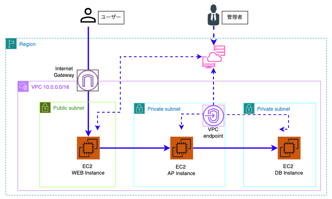

# AWS × Terraform Web/AP/DB 3層インフラ基盤ポートフォリオ

AWSのベストプラクティスに基づき、堅牢なセキュリティ（SSM・サブネット多層分離・最小権限SG）とコスト最適化を両立させた Web/AP/DB の標準的な3層システム基盤をTerraform（IaC）でモジュール化して自動構築したプロジェクトです。

---

## 🏛️ アーキテクチャ構成図



---

## 🎯 設計のポイントとアピール要素

### 1. 多層防御を考慮したネットワーク・セキュリティ設計（SAA/SAP基準）
* **Web / AP / DB サブネットの完全分離**
  * **Public Subnet (10.0.1.0/24)**: 外部ネットワークからの通信の入り口となる Web 層を配置。
  * **Private AP Subnet (10.0.2.0/24)**: ビジネスロジックを担う AP 層をインターネットから隔離された閉域網に配置。
  * **Private DB Subnet (10.0.3.0/24)**: 重要なデータ層は独立した閉域サブネットへ隔離。
* **22番（SSH）ポートの完全閉塞と AWS SSM Session Manager 導入**
  * SSH (22/TCP) ポートを開放せず、AWS Systems Manager (SSM) Session Manager 経由でリモートアクセスを制御。
  * 踏み台（Bastion）サーバー不要とし、管理コスト低減・鍵漏洩リスクの排除を実現。
* **最小権限のセキュリティグループ（カスケード制御）**
  * `web-sg`: 外部からの HTTP (80/TCP) 通信を許可。
  * `ap-sg`: `web-sg` からの通信 (8080/TCP) のみを許可。
  * `db-sg`: `ap-sg` からの通信 (3306/TCP) のみを許可し、Web層からの直接アクセスは完全遮断。

### 2. 攻撃対象面（Attack Surface）の最小化（Minimal OSアプローチ）
* 近年多発するミドルウェア・ランタイム層（Webサーバーやプログラミング言語環境等）の緊急脆弱性リスクを鑑み、OS起動時点では不要なパッケージやミドルウェアを含めない**最小構成（Minimal Infrastructure）**を採用。
* 実運用時はマネージドサービス（Amazon RDS）や構成管理ツール（Ansible/コンテナ）を用いた適切なデプロイラインを前提とし、本ポートフォリオではインフラ基盤（IaC）の再現性に特化。

### 3. Terraform による完全モジュール化（IaC）
* `vpc` / `security_group` / `ec2` の機能別にモジュールを分離し、高い再利用性と保守性を実現。
* `data "aws_ami"` を活用し、Amazon Linux 2023 の最新 AMI を自動取得。

---

## 🛠️ 使用技術・環境

| 分類 | 採用技術 |
| :--- | :--- |
| **Cloud** | AWS (VPC, Subnet, EC2, Elastic IP, IAM, SSM) |
| **IaC** | Terraform (v1.2+) / AWS Provider (v5.x) |
| **OS** | Amazon Linux 2023 (Web / AP / DB) |
| **Security** | IAM Role (AmazonSSMManagedInstanceCore), Security Group |

---

## 📂 ディレクトリ構造

```text
terraform/
├── main.tf              # モジュール結合・メイン定義
├── variables.tf         # ルート変数定義
├── terraform.tfvars     # パラメータ設定値
├── providers.tf         # AWSプロバイダー設定
├── outputs.tf           # 構築後のIPアドレス等の出力定義
└── modules/
    ├── vpc/             # VPC, Subnet (Public/AP/DB), Route Table定義
    ├── security_group/  # Web / AP / DB 用階層型SG定義
    └── ec2/             # IAM Role(SSM), EC2(3台), EIP定義
