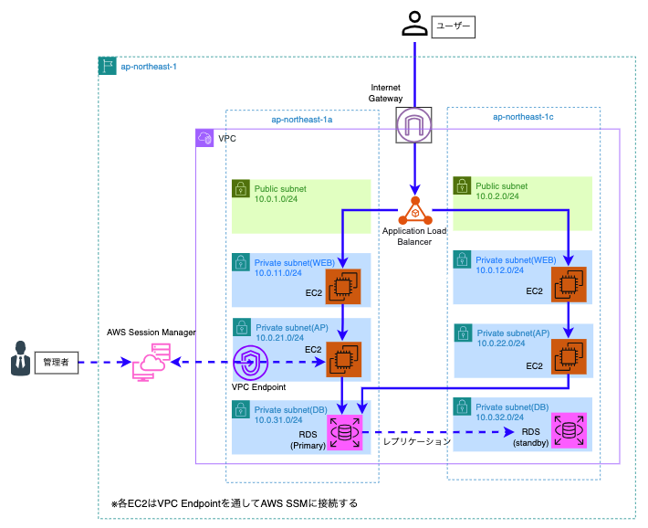

# AWS 高可用性 Web/AP/DB 3層アーキテクチャ（Terraform）

AWS 上にマルチAZ冗長化、多層防御、および踏み台レスなセキュア運用を組み込んだ 3層アーキテクチャを Terraform（IaC）で構築したポートフォリオです。

---

## 1. システム構成図

---

## 2. アーキテクチャの設計思想と特徴

### ① Multi-AZ による高可用性（HA）
- `ap-northeast-1a` と `ap-northeast-1c` の 2 つのアベイラビリティゾーンに Web・AP・DB 層を分散配置。
- 単一のデータセンター障害が発生した場合でも、サービス継続が可能な耐障害性を確保。

### ② 多層防御（ゼロトラスト志向の閉域化）
- インターネット境界には ALB（Application Load Balancer）のみを配置。
- Web・AP・DB はすべてプライベートサブネットに隔離し、前段からの特定ポートのみをセキュリティグループで連鎖的に許可（ALB ➔ Web ➔ AP ➔ DB）。

### ③ ALB による負荷分散と自動切り離し
- 2台の Web インスタンスへのトラフィック分散。
- ヘルスチェック（`/` 監視）により、異常インスタンスを検知してトラフィックから自動除外。

### ④ RDS Multi-AZ による耐障害性とデータ保護
- Primary（1a）から Standby（1c）への**同期レプリケーション**を確立。
- 定常時は両 AP サーバから Primary へアクセスし、障害発生時は自動フェイルオーバーによってダウンタイムを最小化。

### ⑤ 踏み台レス・セキュアな運用管理
- インターネットに露出する踏み台 EC2 や SSH 鍵の管理を排除。
- **AWS Systems Manager (SSM) Session Manager** および Interface 型 VPC エンドポイント（ssm, ssmmessages, ec2messages）経由で、閉域内の AP サーバへ安全にアクセス。
- RDS のメンテナンス時は、AP サーバを中継点とした SSM ポートフォワーディングにより、ローカル端末から安全に接続可能。

---

## 3. ディレクトリ構成

Terraform コードは責務ごとにモジュール分割し、保守性・再利用性を高めています。

terraform/
├── main.tf                  # 各モジュールの呼び出し・結合
├── variables.tf             # 共通変数定義
├── outputs.tf               # 作成リソースの出力（ALB DNS名、IP等）
├── terraform.tfvars         # 環境固有の変数値
└── modules/
    ├── vpc/                 # 8サブネット（Public/Web/AP/DB × 2AZ）+ IGW + ルートテーブル
    ├── security_group/      # 各層のセキュリティグループ（チェーン構造）
    ├── alb/                 # ALB本体、ターゲットグループ、リスナー
    ├── ec2/                 # Web/AP インスタンス、IAMロール、SSM VPCエンドポイント
    └── rds/                 # DBサブネットグループ、RDS Multi-AZ インスタンス
