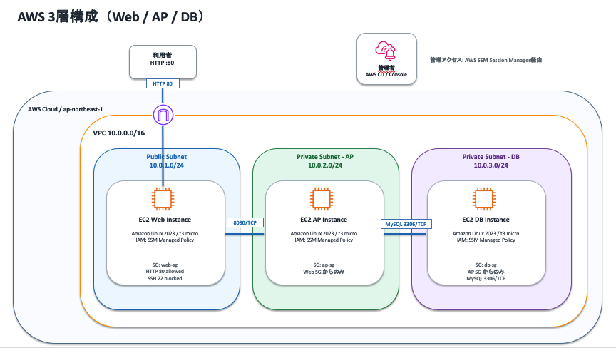

# AWS × Terraform インフラ自動構築ポートフォリオ

AWSのベストプラクティスに基づき、セキュリティ（SSM・サブネット分離・最小権限）とコスト最適化を両立させたWeb/AP/監視インフラをTerraform（IaC）でモジュール化して構築したプロジェクトです。

---

## 🏛️ アーキテクチャ構成図



---

## 🎯 設計のポイントとアピール要素

### 1. 堅牢なセキュリティ設計（SAA/SAP基準）
* **Public/Private サブネットの完全分離**
  * 外部からの直接トラフィックを受ける Web/Proxy サーバーのみを Public Subnet に配置。
  * AP サーバー（Docker基盤）および Monitor サーバー（Zabbix）は Private Subnet に隔離し、インターネットからの直接攻撃リスクを排除。
* **22番（SSH）ポートの完全閉塞と AWS SSM Session Manager 導入**
  * SSH用インバウンドポートを開放せず、AWS Systems Manager (SSM) Session Manager 経由でのリモートアクセスを実現。
  * 踏み台（Bastion）サーバーを不要にし、管理コストとセキュリティリスクを削減。
* **最小権限のセキュリティグループ（SG）設計**
  * AP Server は Web Server からの `8080/TCP` 通信のみを許可。
  * Zabbix 監視通信は VPC 内部（`10.0.0.0/16`）からの `10050/10051` ポートのみに制限。

### 2. Terraform による完全モジュール化（IaC）
* `vpc` / `security_group` / `ec2` の機能別にモジュールを分離し、再利用性と保守性の高いコード構造を採用。
* `data "aws_ami"` を活用し、Amazon Linux 2023 や AlmaLinux 9 の最新 AMI を自動取得。

### 3. コスト最適化
* 検証・ポートフォリオ用に全インスタンスタイプを `t3.micro` に統一し、最小限のコストで実用的な3層構造+監視基盤を再現。

---

## 🛠️ 使用技術・環境

| 分類 | 採用技術 / ミドルウェア |
| :--- | :--- |
| **Cloud** | AWS (VPC, EC2, Elastic IP, IAM, SSM) |
| **IaC** | Terraform (v1.2+) / AWS Provider (v5.x) |
| **OS** | Amazon Linux 2023 (Web / AP), AlmaLinux 9 (Monitor) |
| **Middleware** | Apache (Proxy), GroupSession (AP Application), Zabbix Server 7.0 |

---

## 📂 ディレクトリ構造

```text
terraform/
├── main.tf              # モジュール結合・メイン定義
├── variables.tf         # ルート変数定義
├── terraform.tfvars     # パラメータ設定値
├── providers.tf         # AWSプロバイダー設定
├── outputs.tf           # 構築後のIPアドレス等の出力定義
└── modules/
    ├── vpc/             # VPC, Subnet, IGW, Route Table定義
    ├── security_group/  # Web / AP / Zabbix 用SG定義
    └── ec2/             # IAM Role(SSM), EC2, EIP定義
